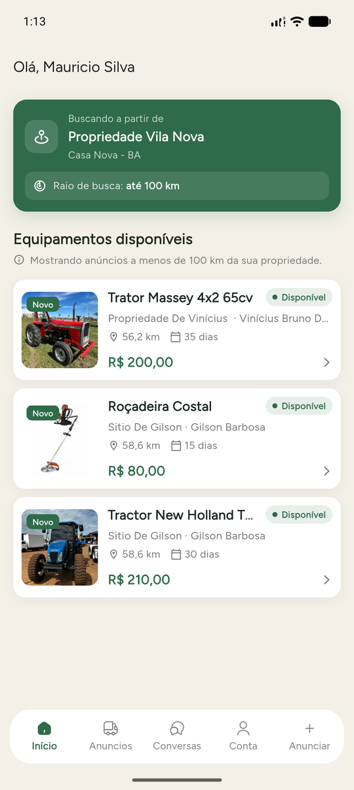
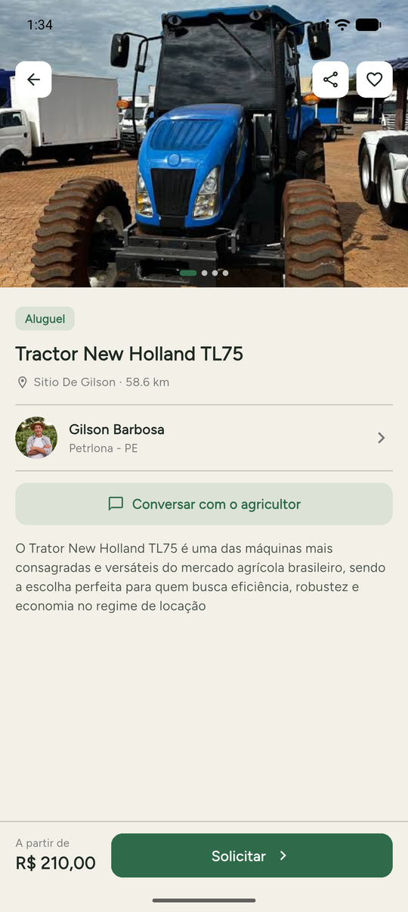
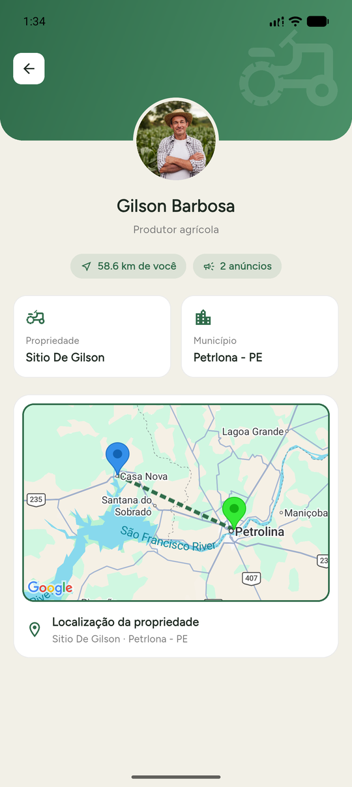

<div align="center">


# AgroMart

**Marketplace para locação de máquinas, implementos e ferramentas agrícolas entre pequenos produtores rurais.**


</div>

---

## Sobre o projeto

O **AgroMart** é um aplicativo mobile que conecta produtores rurais de uma mesma região para **alugar equipamentos agrícolas ociosos**: tratores, roçadeiras, microtratores, implementos e ferramentas em geral.

Hoje a agricultura familiar e de pequeno porte arca com custos altos de mão de obra e de insumos, e a locação tradicional de maquinário costuma ficar concentrada em poucas empresas. O AgroMart propõe outro caminho: o produtor que tem uma máquina parada anuncia no app, e o vizinho que precisa dela aluga diretamente, sem intermediários.

O projeto foi desenvolvido como pesquisa aplicada no curso de **Ciência da Computação da FACAPE** (Petrolina-PE). A primeira implantação está prevista para propriedades próximas a **Petrolina e Juazeiro**.

### Objetivos

**Objetivo geral:** criar um aplicativo de locação entre pequenos produtores que têm insumos ociosos (equipamentos e maquinário) e produtores que precisam desses produtos.

**Objetivos específicos:**
- dar mais relevância à economia informal;
- criar um ambiente onde a pequena agricultura movimente mais capital;
- diminuir o custo inicial da pequena produção agrícola.

### Fundamentação

O app segue o modelo econômico **P2P/C2C** (economia compartilhada) com contratos no formato **dry lease** (locação só do equipamento, sem operador). Ele também foi pensado como um negócio **asset light**: a plataforma não possui nenhum equipamento, só conecta quem tem a quem precisa.

---

## Telas

<table>
  <tr>
    <td align="center"><br /><sub><b>Início</b>: equipamentos próximos</sub></td>
    <td align="center"><br /><sub><b>Detalhes do equipamento</b></sub></td>
    <td align="center"><br /><sub><b>Perfil do anunciante</b> com mapa</sub></td>
    <td align="center"><br /><sub><b>Chat</b> entre produtores</sub></td>
  </tr>
</table>

---

## Funcionalidades

### Cadastro e autenticação
- Login com e-mail e senha (Firebase Authentication).
- Cadastro em etapas: nome, CPF (com máscara e validação), e-mail, senha, foto de perfil e dados da propriedade.
- Localização da propriedade capturada pelo GPS do aparelho (latitude/longitude), usada para calcular distâncias.

### Busca por proximidade
- A tela inicial mostra os equipamentos disponíveis num **raio de até 100 km** da propriedade do usuário.
- Cada anúncio mostra foto, nome, propriedade, dono, distância, período de aluguel e preço.

### Anúncios
- Anunciar equipamento com várias fotos, nome, preço (R$), período de aluguel em dias e descrição.
- Aba **Anúncios** para acompanhar e gerenciar os próprios equipamentos: editar e ver as solicitações recebidas.
- **Aceitar ou recusar** pedidos de aluguel. Depois de aceito, o equipamento sai da lista de disponíveis.

### Solicitação de aluguel
- Na tela de detalhes, o produtor pede o aluguel com um toque em **Solicitar**.
- Em **Meus pedidos** ele acompanha o status de cada solicitação (pendente / aceito), abre o chat com o dono ou cancela o pedido. Se cancelar, o equipamento volta a ficar disponível.

### Perfil do anunciante
- Nome, foto, município, propriedade, quantidade de anúncios e distância até você.
- Mapa (Google Maps) com a localização das duas propriedades e a rota entre elas.

### Chat em tempo real
- Conversa direta com o dono do equipamento, ligada ao anúncio em questão.
- Lista de conversas com a última mensagem e o horário.

### Notificações push
- Avisos via Firebase Cloud Messaging, disparados por Cloud Functions quando:
  - chega uma **nova solicitação** de aluguel (`onNovaSolicitacao`);
  - uma solicitação é **aceita** (`onSolicitacaoAceita`);
  - chega uma **nova mensagem** no chat (`onNovaMensagem`).

---

## Tecnologias

| Camada | Ferramentas |
|---|---|
| App | Flutter, Dart, `material_ui`, Provider (gerência de estado), Google Fonts |
| Backend | Firebase Auth, Cloud Firestore, Firebase Storage, Firebase App Check |
| Notificações | Firebase Cloud Messaging + Cloud Functions (TypeScript, Node 22) |
| Mapas e localização | `google_maps_flutter`, `geolocator` |
| Utilitários | `image_picker`, `file_picker`, `mask_text_input_formatter`, `currency_text_input_formatter`, `intl`, `shimmer` |

---

## Estrutura do projeto

O código segue uma organização **feature-first**:

```
lib/
├── main.dart
├── core/                  # código compartilhado
│   ├── constants/         # regex e constantes
│   ├── navigation/        # navegação global
│   ├── services/          # notificações (FCM)
│   ├── session/           # sessão do usuário logado
│   ├── theme/             # cores do app
│   ├── utils/             # snackbars / mensagens
│   └── widgets/           # componentes reutilizáveis
└── features/
    ├── auth/              # login e cadastro em etapas
    ├── home/              # shell com bottom nav + aba Início
    ├── equipment/         # anúncio, detalhes e gestão de equipamentos
    ├── rental_requests/   # solicitações de aluguel
    ├── chat/              # conversas e mensagens
    └── profile/           # conta e perfil público
functions/                 # Cloud Functions (notificações push)
```

Cada feature fica dividida em `data/`, `models/`, `providers/`, `form/` e `ui/`, conforme a necessidade.

---

## Como executar

### Pré-requisitos
- [Flutter SDK](https://docs.flutter.dev/get-started/install) (Dart `^3.13.2`)
- Um projeto no [Firebase](https://console.firebase.google.com/) com Auth, Firestore, Storage e Cloud Messaging ativados
- Uma chave da API do Google Maps (Maps SDK for Android)
- Android Studio ou um dispositivo/emulador Android

### Passo a passo

```bash
# 1. Clone o repositório
git clone <url-do-repositorio>
cd agro-mart

# 2. Instale as dependências
flutter pub get

# 3. Configure o Firebase (gera lib/firebase_options.dart e google-services.json)
dart pub global activate flutterfire_cli
flutterfire configure

# 4. Crie o arquivo .env na raiz com a chave do Google Maps
echo "MAPS_API_KEY=sua_chave_aqui" > .env

# 5. Rode o app
flutter run
```

> Os arquivos `.env`, `lib/firebase_options.dart`, `google-services.json` e `GoogleService-Info.plist` estão no `.gitignore`. Cada desenvolvedor precisa gerar os seus.

### Cloud Functions (opcional)

```bash
cd functions
npm install
npm run deploy
```

---